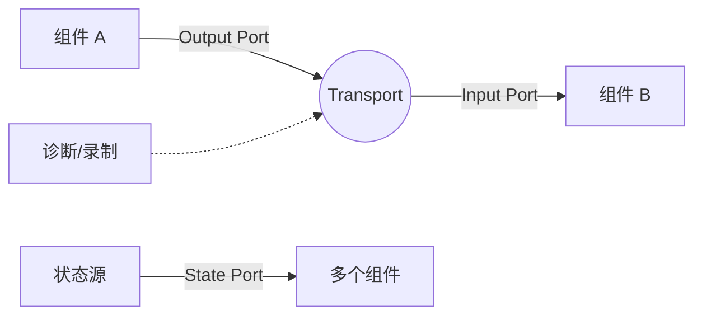
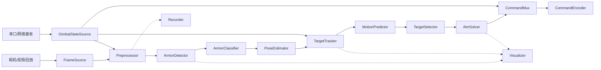

# Aquila RMVision 组件式自瞄框架设计

# 这个也是AI生成的仅作为参考

本文档为 Aquila RMVision 设计一套可以逐步落地的组件式架构。当前仓库仍处于基座阶段，本文只定义边界、契约和运行模型，不要求立即实现全部模块。

设计目标是让相机、检测、识别、位姿解算、跟踪、预测、瞄准、通信和回放都能独立开发、测试、替换，同时保留比赛现场需要的低延迟、低依赖和可控性。

## 1. 设计原则

### 1.1 组件负责能力，运行时负责组织

组件只关心自己的输入、输出和业务逻辑。组件不应该创建其他组件、不应该直接调用其他组件的方法，也不应该自行决定整个进程的线程结构。

运行时负责：

- 读取配置；
- 创建和连接组件；
- 校验端口和消息类型；
- 分配执行器和线程；
- 管理启动、停止、异常和健康状态；
- 提供日志、指标、录制和回放能力。

这样可以把“某个算法怎么做”和“系统怎样运行”分开。

### 1.2 端口优先于直接调用

组件之间通过端口传递消息。组件只依赖端口契约，不依赖对方的具体类名和实现。



端口连接关系可以由配置文件决定，因此同一个检测器可以接相机、视频文件或回放数据。

### 1.3 数据契约稳定，算法实现可替换

组件之间传递的是稳定的数据模型，例如 `ImageFrame`、`ArmorObservation`、`TrackState` 和 `AimCommand`。检测器可以从传统视觉切换到神经网络，跟踪器可以从简单状态机切换到卡尔曼滤波，而上下游接口不必同时重写。

### 1.4 实时链路和离线链路使用同一套契约

相机输入与视频回放都产生 `ImageFrame`，实机通信与录包回放都产生 `GimbalState`。算法不应该通过 `if (replay)` 维护两套逻辑。

## 2. 分层结构

建议把框架分为六层：

```text
┌─────────────────────────────────────────────┐
│ Application / Profile                       │  兵种组合、参数和部署配置
├─────────────────────────────────────────────┤
│ Runtime                                     │  生命周期、调度、异常、健康检查
├─────────────────────────────────────────────┤
│ Component Graph                             │  组件、端口、连接和拓扑校验
├─────────────────────────────────────────────┤
│ Transport                                   │  Latest、Queue、State、Event、Service
├─────────────────────────────────────────────┤
│ Contracts                                   │  消息类型、时间戳、坐标系、版本
├─────────────────────────────────────────────┤
│ Platform Adapters                           │  相机、串口、GPU、模型后端、系统时钟
└─────────────────────────────────────────────┘
```

### 2.1 Contracts：消息契约层

这是最稳定的一层，只放跨组件使用的数据类型和枚举，不放 OpenCV 算法细节、线程对象或硬件句柄。

每一条跨组件消息建议带有统一头部：

```text
MessageHeader
  sequence        单调递增序号
  source          发布组件或设备
  capture_time    数据采集时间
  publish_time    发布到框架的时间
  frame_id        坐标系或图像帧标识
  schema_version  消息版本
```

建议的第一批消息：

| 消息 | 含义 | 主要生产者 | 主要消费者 |
|---|---|---|---|
| `ImageFrame` | 图像、采集时间、曝光和相机标识 | 相机/回放 | 检测器、可视化、录制器 |
| `GimbalState` | 云台角度、底盘姿态、敌我颜色、模式 | 通信接收器 | 检测器、解算器、控制器 |
| `DetectionFrame` | 灯条、装甲板、数字识别和置信度 | 检测器 | 匹配器、跟踪器 |
| `PoseFrame` | 目标三维位置、姿态和重投影误差 | PnP/位姿组件 | 跟踪器、可视化 |
| `TrackState` | 目标状态、速度、角速度、置信度 | 跟踪器 | 预测器、目标选择器 |
| `AimSolution` | 目标角度、距离、预测时间和有效性 | 预测/瞄准组件 | 指令复用器、可视化 |
| `GimbalCommand` | 最终发送给电控的命令 | 指令复用器 | 编码器/串口 |
| `HealthStatus` | 组件运行状态和故障原因 | 每个组件 | 监控器、急停逻辑 |

消息应尽量表达事实，不把决策隐藏在字段名里。例如 `AimSolution` 表示“算法计算出的瞄准解”，`GimbalCommand` 才表示“准备发送给云台的最终命令”。

### 2.2 Transport：通信语义层

不要只提供一种队列。不同数据应该有明确的传输语义：

| 类型 | 语义 | 适合内容 |
|---|---|---|
| `Latest<T>` | 只保留最新值，旧数据可丢弃 | 图像、检测、跟踪状态 |
| `Queue<T>` | 保留顺序，不能静默覆盖 | 控制事件、标定命令、故障事件 |
| `State<T>` | 多订阅者读取同一份最新状态 | 云台状态、模式、敌我颜色 |
| `Event<T>` | 每个事件只处理一次 | 急停、重置跟踪、模式切换 |
| `Service<Request, Reply>` | 请求-响应 | 参数查询、在线标定、诊断 |

视觉帧通常使用 `Latest`，因为处理过时画面没有意义；模式和云台状态通常使用 `State`；急停和清空状态必须使用 `Event`，不能放入会覆盖旧值的 Latest 通道。

每个传输工具都应明确：是否允许多个生产者、是否允许多个消费者、是否阻塞、是否丢帧、是否需要超时，以及关闭时如何唤醒等待线程。

### 2.3 Component Graph：组件和端口层

一个组件由四类信息组成：

```text
ComponentDescriptor
  name                 配置中的稳定名称
  version              组件版本
  input_ports          输入端口及消息类型
  output_ports         输出端口及消息类型
  execution_hint       周期、触发方式和资源需求
  capabilities         可选能力，例如 GPU、相机或串口
```

端口至少应包含：

```text
PortDescriptor
  name                 端口名
  message_type         消息类型
  transport            Latest / Queue / State / Event / Service
  required             是否必须连接
  queue_depth          队列容量或 Latest 的容量说明
  timeout              等待输入的最长时间
```

端口名称应该显式写出语义，例如 `camera/frame`、`vision/detections`、`tracking/state`，不要仅依靠 C++ 类型推断连接关系。相同类型可能同时存在多条链路。

### 2.4 Runtime：生命周期和调度层

建议组件生命周期为：

```text
Construct
  -> Configure
  -> DeclarePorts
  -> Validate
  -> Initialize
  -> Start
  -> Run / Tick
  -> Stop
  -> Shutdown
```

建议接口语义：

- `configure(config)`：读取本组件的参数，不访问其他组件；
- `declare_ports(graph)`：声明输入输出及传输语义；
- `initialize(resources)`：加载模型、打开设备、创建推理后端；
- `start()`：启动内部资源，但不创建永久业务循环；
- `process(context)` 或 `on_message()`：执行一次工作单元；
- `stop()`：停止接收新数据并唤醒阻塞等待；
- `health()`：返回运行状态、最近处理时间和错误信息。

组件不应在构造函数中打开相机、加载大模型或启动线程，因为构造阶段还没有完成配置和拓扑校验。

## 3. 自瞄系统的推荐组件图

第一版可以按以下链路拆分：



### 3.1 FrameSource

统一相机、视频和录包回放的输入。

职责：

- 产生单调递增的图像帧序号；
- 填充采集时间、曝光、增益和相机标识；
- 报告断流、重连和帧率；
- 允许离线回放控制速度或逐帧执行。

不负责检测、颜色判断或坐标解算。

### 3.2 GimbalStateSource

负责读取电控或底盘状态，解析协议，并发布统一的 `GimbalState`。

协议字段和内部消息必须隔离。串口字节、CRC 和协议版本不应该传到算法组件。

### 3.3 Preprocessor

负责裁剪、缩放、颜色空间转换、畸变校正和相机时间对齐。预处理参数应属于配置，而不是写死在检测器里。

### 3.4 ArmorDetector

输出候选灯条、装甲板角点、目标颜色、置信度和模型版本。它可以有多个实现：

- `TraditionalDetector`：灯条和几何规则；
- `YoloDetector`：神经网络检测；
- `ReplayDetector`：从标注或录包直接读取结果。

这些实现共享同一个 `DetectionFrame` 契约。

### 3.5 ArmorClassifier

负责数字识别、装甲板类型和敌我过滤。检测器不应该同时承担所有分类决策，否则模型替换和问题定位会变困难。

### 3.6 PoseEstimator

根据角点、相机标定和装甲板尺寸输出三维位姿。该组件应显式记录：

- 相机坐标系；
- 云台坐标系；
- 车体坐标系；
- 变换时间戳；
- PnP 方法和重投影误差。

坐标系名称应作为消息字段或变换树的一部分存在，不能依赖注释记忆正负方向。

### 3.7 TargetTracker

负责目标关联、状态机和丢失恢复。建议先支持：

```text
Lost -> Detected -> Tracking -> TemporarilyLost -> Lost
```

跟踪器应输出目标状态和置信度，不直接生成发射命令。

### 3.8 MotionPredictor

负责根据时间延迟、目标速度和角速度预测未来位置。预测组件必须读取实际延迟，而不是只使用固定经验值：

```text
prediction_time = sensor_delay
                  + inference_delay
                  + communication_delay
                  + gimbal_response_delay
```

### 3.9 AimSolver

将目标位置转换为 yaw、pitch 和距离，处理弹道补偿、重力补偿和坐标系变换。输出应包含 `valid`、`reason`、`target_id`、`source_sequence` 和计算时间。

### 3.10 CommandMux

这是安全边界组件，负责把自动瞄准、符文、前哨、手动控制和急停合并成唯一的 `GimbalCommand`。

它必须检查：

- 模式是否允许自动输出；
- 状态是否超时；
- 目标是否有效；
- 云台是否处于可控状态；
- 是否触发急停或失联降级。

任何算法组件都不应绕过 `CommandMux` 直接写串口。

## 4. 调度模型

建议同时支持三种执行方式。

### 4.1 Source-driven

输入到达时唤醒组件，适合相机采集、串口接收和回放读取。

### 4.2 Periodic

按照固定频率执行，适合控制输出、健康检查和状态发布。

### 4.3 Event-driven

收到事件才执行，适合急停、重置跟踪和模式切换。

配置可以表达为：

```yaml
components:
  - name: camera
    type: CameraSource
    executor: io
    trigger: source

  - name: detector
    type: YoloDetector
    executor: vision
    trigger: source
    input: camera/frame
    output: vision/detections

  - name: command_mux
    type: CommandMux
    executor: control
    trigger: periodic
    rate_hz: 200
```

执行器是线程资源，组件是业务资源。多个轻量组件可以共享一个执行器；模型推理、相机 SDK 和串口 IO 可以分别放入不同执行器。

组内共享线程时，必须为每个组件定义超时和最大处理时间，防止一个阻塞组件拖住整条链路。

## 5. 配置和部署模型

建议配置分成三层：

```text
profiles/competition.yaml    组件组合和运行模式
config/components/*.yaml     单个组件参数
calibration/*.yaml           相机、云台和坐标系标定
```

组件配置示例：

```yaml
profile: auto_aim

components:
  - name: frame_source
    type: CameraSource
    library: aquila_camera
    config: config/components/camera.yaml

  - name: detector
    type: YoloDetector
    library: aquila_detector_yolo
    config: config/components/detector.yaml

connections:
  - from: frame_source/frame
    to: detector/frame
    transport: latest
  - from: gimbal_state/state
    to: pose_estimator/gimbal_state
    transport: state
```

配置校验必须在启动前完成。典型错误包括：消息类型不匹配、必需端口未连接、重复生产者、未声明的 Topic、循环依赖和组件能力缺失。

动态库不是第一天的硬性要求。建议先支持静态链接组件和稳定的接口测试，再引入动态加载；否则 ABI、符号可见性和调试问题会过早增加复杂度。

## 6. 建议的仓库目录

结合当前 Aquila 仓库，后续可以演进为：

```text
src/
  core/
    contracts/       跨组件消息和枚举
    component/       组件接口、端口和描述符
    transport/       Latest、Queue、State、Event
    runtime/         配置、拓扑、生命周期、调度器
    diagnostics/     日志、指标、录制、回放接口
    math/             坐标系、角度和时间工具

  platform/
    camera/           相机 SDK 适配
    serial/           串口和协议适配
    inference/        ONNX/TensorRT 等后端适配
    clock/            系统时钟和回放时钟

  components/
    input/            CameraSource、ReplaySource、GimbalStateSource
    vision/           Preprocessor、Detector、Classifier、PoseEstimator
    tracking/         Tracker、Predictor、TargetSelector
    control/          AimSolver、CommandMux、CommandEncoder
    tools/            Recorder、Visualizer、HealthMonitor

config/
  profiles/
  components/
  calibration/

docs/
  component-architecture.md
  contracts/
  coordinate-frames.md
  replay-format.md

tests/
  contracts/
  transport/
  components/
  replay/
```

当前的 `src/hello_world.cpp` 可以继续保留为最小构建验证目标。新增框架代码时，不要让 Hello World 直接承担运行时职责。

## 7. 观测、录制和回放

可观测性应该是框架能力，不应由每个算法组件自行实现一套日志格式。

每个组件至少应报告：

- 调用次数和成功次数；
- 最近一次输入序号；
- 输入到输出的处理耗时；
- 当前输入年龄；
- 丢帧数量；
- 队列占用；
- 最近错误和健康状态。

录制器建议记录消息头部和必要载荷，并支持按 Topic 选择：

```text
recording/
  manifest.yaml
  image_frame.mcap
  gimbal_state.mcap
  detections.mcap
  commands.mcap
```

回放必须能够复现相同的消息顺序和时间戳。算法调试优先使用回放，而不是每次都连接实车。

## 8. 安全和实时约束

自瞄框架需要把“算法正确”和“系统安全”分开。

### 8.1 数据新鲜度

每个输入都应有最大允许年龄。例如：

```text
gimbal_state: 50 ms
track_state: 100 ms
aim_solution: 80 ms
```

超过期限时，`CommandMux` 应输出无效或安全命令，而不是继续使用旧数据。

### 8.2 故障降级

建议至少定义以下降级状态：

```text
Normal
NoTarget
StaleInput
ComponentError
CommunicationLost
EmergencyStop
```

降级状态应体现在 `HealthStatus` 和 `GimbalCommand` 中，并能在日志和回放中追踪。

### 8.3 资源隔离

相机线程、推理线程、控制线程和录制线程要有明确的资源边界。模型加载失败不应该导致配置解析阶段崩溃；串口断开也不应该让视觉线程永久阻塞。

## 9. 推荐的落地顺序

### 阶段 A：契约和传输最小闭环

- 定义 `MessageHeader`、`ImageFrame`、`GimbalState`、`DetectionFrame`、`AimSolution`；
- 实现 `Latest`、`State` 和 `Event`；
- 用内存组件跑通 `ReplaySource -> FakeDetector -> FakeAimSolver -> Recorder`；
- 完成端口类型检查和关闭语义。

验收：不接相机和串口，也能用固定输入稳定回放并产生可检查的输出。

### 阶段 B：组件生命周期和执行器

- 实现 `configure/initialize/start/stop`；
- 实现 source、periodic、event 三种触发方式；
- 增加超时、健康状态和处理耗时统计；
- 让运行时可以优雅退出。

验收：组件异常时能报告并停止，程序不会永久卡在不可关闭的等待中。

### 阶段 C：替换真实输入输出

- 加入相机适配器；
- 加入串口状态接收和命令发送；
- 加入坐标系和标定配置；
- 保持回放输入仍然可用。

验收：同一套算法可以在实时相机和离线回放之间切换。

### 阶段 D：算法组件逐步替换

- 传统检测器；
- 神经网络检测器；
- 数字识别；
- PnP；
- 跟踪和预测；
- 指令复用和安全门控。

每替换一个组件，都要用同一份输入回放做精度和延迟回归。

### 阶段 E：动态插件和多兵种 Profile

当组件契约稳定后，再引入动态库加载、组件版本和不同兵种 Profile。动态加载是部署手段，不应该成为早期架构正确性的前提。

## 10. 与参考项目的关系

参考项目的 `PluginBase + Context + LatestBuffer/LatestChannel` 思路适合作为通信和插件化的起点，尤其适合低延迟的一对一视觉流水线和一对多状态广播。

Aquila 建议在其基础上增加：

1. 明确的命名端口，而不是只按 C++ 类型匹配；
2. `Queue`、`Event` 和 `Service` 等额外通信语义；
3. 完整生命周期和可停止线程；
4. 统一消息头、时间戳和坐标系；
5. 数据新鲜度和安全门控；
6. 录制、回放、指标和健康检查；
7. 先静态组件、后动态插件；
8. 把硬件协议和算法消息隔离。

这样设计后，组件既可以在单进程内低延迟运行，也可以在未来需要时迁移到多进程或 ROS 2，而不必重写业务接口。

## 11. 需要在实现前确认的问题

1. 第一阶段目标平台是 Linux、Windows，还是两者都支持？
2. 相机和串口是否必须在同一个进程中运行？
3. 是否需要录包回放和仿真作为正式运行模式？
4. 自瞄、符文、前哨和手动控制是否共用同一个 `CommandMux`？
5. 视觉链路允许丢帧的最大程度是多少？
6. 控制输出的周期、超时和急停行为是什么？
7. 模型后端是否需要在运行时切换？
8. 坐标系、标定文件和协议版本由谁维护？

这些问题会直接影响 Transport、Executor、消息契约和部署方式，应在正式写实现前形成一页决策记录。
